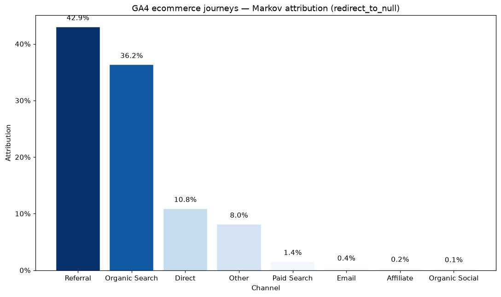
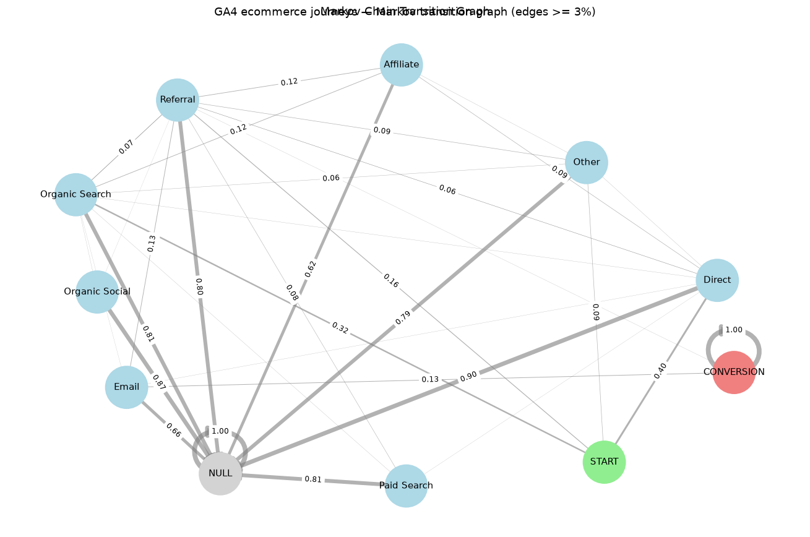
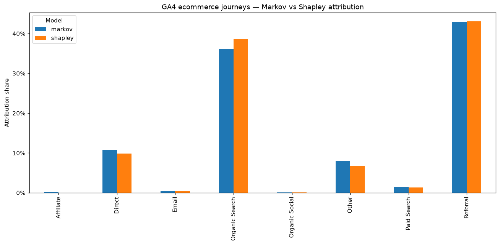
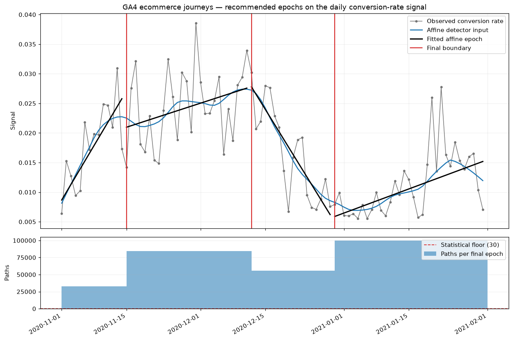
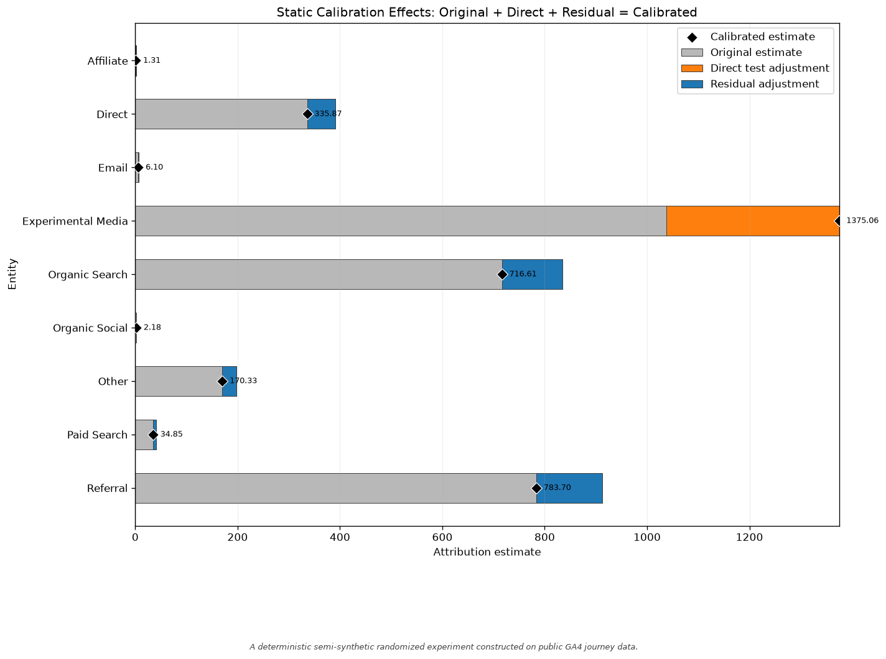
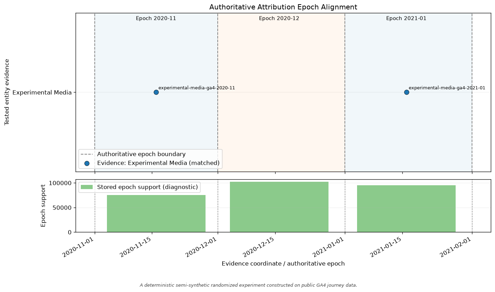
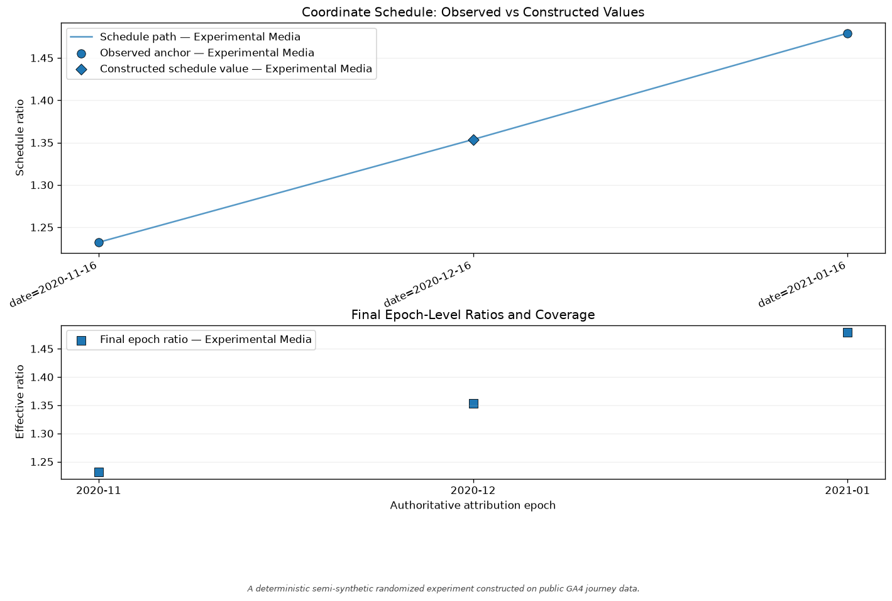
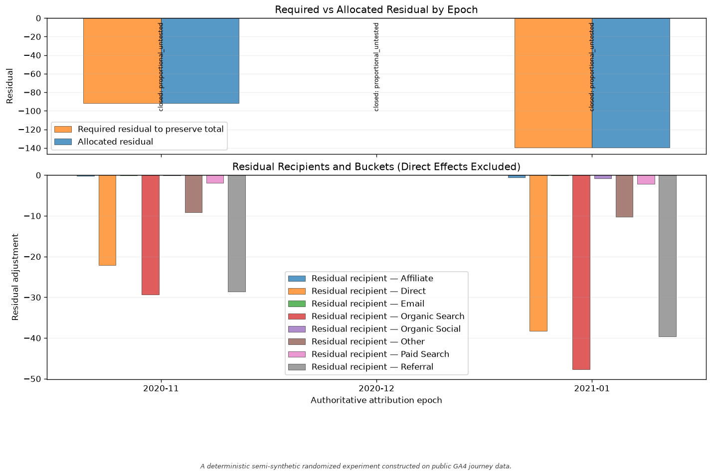

# do-attribution

**Multi-touch attribution and experimental calibration for Python —
closed-form Markov, exact Shapley, temporal attribution, and explicit
calibration from external lift-test evidence.**


`do-attribution` has two explicit layers:

```text
journey data        → attribution
external experiment → post-attribution calibration
```

The attribution layer turns customer journeys such as
`"Email > Social > Purchase"` and a `0/1` conversion flag per journey into
raw per-channel model diagnostics and, when those values satisfy the
normalization contract, per-channel shares using two observational
allocation models:

- an **absorbing-Markov-chain removal-effect** model
  (`MarkovAttribution`, orders 1+, four removal strategies), and
- a **cooperative-game Shapley-value** model (`ShapleyAttribution`, exact
  Shapley values of a coalition game built from the observed channel sets).

The calibration layer applies caller-supplied lift-test evidence after a
static or temporal attribution fit. Direct adjustments to tested entities,
residual allocation to other entities, temporal evidence schedules, and
provenance remain separate and inspectable.

Around these layers the package ships side-by-side model comparison
(`CompareAttribution`), explicit conversion-endpoint handling
(`conversion_labels`), plain-text reporting (`summary()`), flat DataFrame
export (`to_dataframes()`), matplotlib/networkx visualizations, and temporal
epoch analysis (`TemporalMarkovAttribution`, `TemporalShapleyAttribution`,
`recommend_epochs`) that refits the same static models independently inside
chronological epochs.

> **Scope guard:** attribution outputs are probabilistic decompositions of
> observed co-occurrence between channel exposure and conversion — **not
> causal inference**. A high share means the model assigned relatively more
> normalized attribution to the channel from the observed paths; it does not
> identify the channel that caused a conversion. Calibration can apply
> external experimental evidence, but it does not convert attribution
> internals into causal effects or replace sound experimental design.

---

## Key capabilities

- **Deterministic, closed-form Markov attribution.** Removal effects come
  analytically from the absorbing-chain fundamental matrix `(I − Q)⁻¹` — no
  Monte Carlo, no seed, no simulation count. Identical inputs always produce
  identical outputs.
- **Four removal-effect definitions.** `removal_strategy=` `"fail"`,
  `"fail_refit"` (signed effects), `"detour"` (signed effects), or
  `"redirect_to_null"` — four operational meanings of "remove this channel",
  selected explicitly instead of implied.
- **Exact Shapley values.** The default cumulative coalition game credits a
  coalition with every conversion on journeys whose channels it contains, so
  the Shapley values are a non-negative allocation of all observed
  conversions. They are exact — no sampling — and equal the factorial-weight
  definition `w(s, n) = s!·(n−s−1)!/n!`. Raw values and the observed
  coalition table are always returned; normalized shares are returned when
  the raw values admit a valid share vector, and reported as unavailable
  when they do not. The legacy exact-set game remains available through
  `characteristic_function="exact"`.
- **Conservation and contract guarantees.** When normalized attribution is
  available its shares are finite, lie on `[0, 1]`, and sum to 1, and
  attributed conversions conserve the observed total. When it is not,
  `attribution` is `None` with a machine-readable status and reason rather
  than a fabricated share vector. `redirect_to_null` removal effects are
  nonnegative by construction, and absorption probabilities stay on
  `[0, 1]` — enforced by the implementation.
- **Model reporting.** Every fitted model renders a compact ASCII `summary()`
  or a natural-language `summary(output_format="report")` — plain Python
  strings with bounded, distilled detail tables (signed removal effects, top
  transitions and drop-offs, top coalitions, path diagnostics).
- **Flat DataFrame export.** Static and temporal models expose
  `to_dataframes() -> dict[str, pd.DataFrame]`: flat, string-keyed,
  Parquet/SQL-ready tables for attribution, raw model values, and fit or
  sample diagnostics — no text parsing, no `MultiIndex`, no lazy refits.
- **Visualization.** `plot_attribution`, `plot_removal_effects`,
  `plot_transition_graph`, `plot_coalition_values`,
  `plot_attribution_comparison`, and `plot_epoch_recommendation` each return
  a `matplotlib.figure.Figure`.
- **Temporal epoch analysis.** Calendar buckets (`freq=`), explicit labels
  (`fit_by_epoch`), or data-driven boundaries
  (`recommend_epochs` + `fit_recommended`) — every epoch is an independent
  static fit; complete paths are never split across epochs.
- **Experimental calibration.** Apply externally supplied lift-test evidence
  to static or fixed-epoch attribution results while keeping direct test
  adjustments, residual allocation, evidence schedules, epoch-level
  reductions, and provenance explicitly separate.
- **Calibration diagnostics.** One static adjustment-decomposition plot and
  seven temporal diagnostics show evidence alignment, ratio construction,
  experiment-reported evidence uncertainty, direct adjustments, residual
  allocation, entity mix, and evidence strength.
- **Reproducible outputs.** Deterministic model fits, deterministic
  renderers, and deterministic tie ordering — identical inputs always
  produce identical reports, tables, and figures.

Core runtime dependencies are `numpy` and `pandas`.

---

## Installation

```bash
pip install do-attribution
```

| Extra | Installs | Enables |
| --- | --- | --- |
| `viz` | `matplotlib`, `networkx` | all plotting helpers |
| `temporal` | `statsmodels`, `ruptures` | global-signal epoch recommendation |
| `excel` | `openpyxl` | Excel-friendly workflows |
| `dev` | all of the above + `pytest` | running the test suite |

```bash
pip install "do-attribution[viz]"
pip install "do-attribution[temporal,viz]"
```

Requires Python **3.10 or newer**.

---

## Quick start

A complete, runnable analysis — ten journeys, a fitted Markov model, shares,
and a readable report:

```python
from do_attribution import MarkovAttribution

journeys = [
    "Email > Social > Purchase",
    "Search > Email > Purchase",
    "Social > Purchase",
    "Email > Search",                       # no conversion
    "Search > Social > Email > Purchase",
    "Direct > Purchase",
    "Email > Social",                       # no conversion
    "Search > Email > Social > Purchase",
    "Social > Email > Purchase",
    "Search",                               # no conversion
]
conversions = [1, 1, 1, 0, 1, 1, 0, 1, 1, 0]

model = MarkovAttribution(
    order=1,
    removal_strategy="redirect_to_null",
    conversion_labels=["Purchase"],   # endpoint token, not a channel
    return_transition_matrix=True,
)
result = model.fit(journeys, conversions)

print({ch: round(share, 4) for ch, share in result["attribution"].items()})
print(f"P(conversion | start) = {result['total_conversion_probability']:.4f}")
print(model.summary())
```

Output (abridged — the summary continues with top transitions, drop-off
bottlenecks, and path diagnostics):

```text
{'Direct': 0.085, 'Email': 0.3912, 'Search': 0.1913, 'Social': 0.3324}
P(conversion | start) = 0.7000
Attribution Summary
Model: MarkovAttribution
Epoch source: static
Overall: 10 paths, 7 conversions, 70.00% conversion rate

Data
+-----------+-------+-------------+---------+--------------------------------------------+
| Cohort    | Paths | Conversions | Conv. % | Top channels                               |
+-----------+-------+-------------+---------+--------------------------------------------+
| All paths | 10    | 7           | 70.00%  | Email 39.12%, Social 33.24%, Search 19.13% |
+-----------+-------+-------------+---------+--------------------------------------------+

Removal effects (raw, signed) vs normalized shares
+---------+----------------+--------+
| Channel | Removal effect | Share  |
+---------+----------------+--------+
| Email   | +0.6571        | 39.12% |
| Social  | +0.5584        | 33.24% |
| Search  | +0.3214        | 19.13% |
| Direct  | +0.1429        | 8.50%  |
+---------+----------------+--------+
```

The Shapley model is a drop-in alternative on the same inputs:

```python
from do_attribution import ShapleyAttribution

shapley = ShapleyAttribution(conversion_labels=["Purchase"]).fit(journeys, conversions)

print(shapley["normalization_status"])
# available
print({ch: round(share, 4) for ch, share in shapley["attribution"].items()})
# {'Direct': 0.1429, 'Email': 0.3095, 'Search': 0.1667, 'Social': 0.381}
print({ch: round(v, 4) for ch, v in shapley["shapley_values"].items()})
# {'Direct': 1.0, 'Email': 2.1667, 'Search': 1.1667, 'Social': 2.6667}
```

Each converting journey splits its conversion equally among the distinct
channels it touched, so the raw values sum to the seven observed conversions
and the shares are those values divided by seven. `attribution` is `None`
when normalization is unavailable — for the default game, only when no
conversion can be credited to a channel — so code that must handle that case
should check `normalization_status` before indexing it.

Lists, NumPy arrays, and pandas Series all work as path and conversion
inputs. Both must be one-dimensional: a bare string, a scalar, or a nested or
two-dimensional container raises instead of being read as a collection of
journeys. Each conversion outcome must be exactly `0` or `1`. Integers,
booleans, and the exact numeric values `0.0` / `1.0` are accepted in any of
those containers. The canonical strings `"0"` and `"1"` (text or bytes)
remain accepted as well; no other spelling (`" 1"`, `"01"`, `"1.0"`,
`"true"`) is. Every `fit` entry point — static, temporal (`fit` and
`fit_by_epoch`), and `CompareAttribution` — and the `validate_data` /
`to_int_array` helpers check the supplied values before integer conversion
and raise a `ValueError` naming the position and the original value for a
fractional, out-of-range, missing (`None`, `NaN`, `pd.NA`), or non-finite
outcome.

> **Compatibility — binary outcomes:** this enforces the existing
> binary-outcome contract. Earlier releases cast outcomes to integers before
> checking them, so `[0.9, 1.9]` was silently fitted as `[0, 1]`. Callers
> passing probabilities or fractional counts must supply valid `0`/`1`
> journey outcomes rather than relying on truncation.

---

## Visual examples

The GA4 ecommerce example shows how the package allocates attribution across
channels, represents journey transitions, compares model outputs, and
identifies candidate temporal boundaries.

| | |
| :---: | :---: |
|  |  |
| `plot_attribution` — Markov attribution shares by channel | `plot_transition_graph` — fitted journey transitions with edges ≥ 3% |
|  |  |
| `plot_attribution_comparison` — Markov and Shapley attribution on the same journeys | `plot_epoch_recommendation` — candidate and retained epoch boundaries on the conversion-rate signal |

Calibration diagnostics keep experimental evidence, constructed calibration
ratios, direct adjustments, and policy-based residual allocation visually
distinct.

| | |
| :---: | :---: |
|  |  |
| Decomposes the calibrated estimate into original attribution, direct test adjustment, and residual allocation | Shows where experimental evidence falls on caller-defined epochs without redefining the epoch boundaries |
|  |  |
| Distinguishes observed experimental anchors from constructed epoch-level calibration ratios | Shows the required residual adjustment and its policy-based allocation across eligible recipients |

---

## Experimental calibration

`LiftTestEvidence` represents external experimental evidence for one tested
entity: an observed lift and the attribution estimate matched to the same
population, outcome, and window, plus identifying metadata and optional
uncertainty and temporal coordinates. Its calibration ratio is:

```text
calibration ratio = observed lift / matched attribution estimate
```

Optional `standard_error` is validated and retained on the
`LiftTestEvidence` record as experimental evidence metadata and provenance.
Deterministic point calibration does not use or propagate it: changing
`standard_error` does not change the calibration ratio, direct adjustment,
residual allocation, or calibrated total.
Calibrated point outputs therefore do not supply confidence intervals,
posterior uncertainty, or uncertainty-adjusted calibration ratios.

The standard error is displayed wherever the evidence itself is displayed,
as the experiment's reported uncertainty about its own observed lift:

- `summary()` (static and temporal) prints an
  `Observed lift ± standard error` line under each evidence record, for
  example `360.00 ± 25.00 (standard error reported by the experiment;
  calibration does not use it)`. A record without one prints
  `360.00; no uncertainty supplied`.
- The temporal `to_dataframes()["evidence"]` table carries `observed_lift`,
  `standard_error`, and `uncertainty_status` beside each record;
  `uncertainty_status` reads `standard error reported by the experiment` or
  `no uncertainty supplied`, so a missing value is never an implied zero.
- `plot_evidence_uncertainty()` draws each evidence record's observed lift
  on a lift axis with a horizontal ±1 standard-error bar, and labels a record
  without one `no uncertainty supplied`. `plot_ratio_schedule()` draws the
  same reported error on its observed anchors, divided by the matched
  attribution estimate so it sits on the ratio axis. Constructed schedule
  values, effective ratios, and calibrated estimates never carry a bar.

Changing `standard_error` changes those annotations only; every calibrated
number, schedule, and provenance record is identical.

`AttributionCalibration` applies that evidence to caller-approved static
attribution estimates. `TemporalAttributionCalibration` applies dated
evidence to estimates on a caller-supplied, authoritative epoch grid; the
evidence coordinates do not redefine the epochs.

Every static application requires an explicit residual policy. Every temporal
application additionally requires an explicit ratio policy and epoch-ratio
policy. The result keeps the tested entity's evidence-backed direct adjustment
separate from any residual allocated to untested entities. Those recipient
changes are policy allocations, not effects measured by the experiment.
Interpolated schedule values and constant-policy values transported to
declared epochs are constructed values, not new experimental observations.

This runnable example uses the full-period values and evidence identity from
the calibration notebook:

```python
from do_attribution import AttributionCalibration, LiftTestEvidence

attributed_conversions = {
    "Experimental Media": 1037.8436,
    "Referral": 912.5517,
    "Organic Search": 834.4344,
    "Direct": 391.0936,
    "Other": 198.3367,
    "Paid Search": 40.5804,
    "Email": 7.1016,
    "Organic Social": 2.5363,
    "Affiliate": 1.5218,
}

evidence = LiftTestEvidence(
    tested_entity="Experimental Media",
    observed_lift=1375.0555,
    matched_mta_estimate=attributed_conversions["Experimental Media"],
    test_id="experimental-media-ga4-full-eligible-period",
    outcome_name="journey conversion",
)

calibration = AttributionCalibration([evidence])
calibrated = calibration.apply_estimates(
    estimates=attributed_conversions,
    residual_policy="proportional_untested",
    eligible_entities=[
        entity
        for entity in attributed_conversions
        if entity != evidence.tested_entity
    ],
)

print(calibrated.summary())
figure = calibrated.plot_calibration_effects()
```

Calibration consumes attribution estimates that the caller has already
reviewed and approved. It does not reinterpret Markov removal effects,
Shapley values, or other attribution internals as causal effects, and it does
not choose the experiment, matching design, or calibration policies for the
caller.

See [`docs/calibration.md`](https://github.com/8139CAUSAL/do_attribution/blob/v0.0.2/docs/calibration.md)
for the policy contract,
[`docs/calibration_examples.md`](https://github.com/8139CAUSAL/do_attribution/blob/v0.0.2/docs/calibration_examples.md)
for static
examples, and
[`docs/calibration_examples_temporal.md`](https://github.com/8139CAUSAL/do_attribution/blob/v0.0.2/docs/calibration_examples_temporal.md)
for temporal schedules and epoch reduction.

---

## Supported attribution methods

### Markov removal-effect attribution

`MarkovAttribution(order=k)` models journeys as an absorbing Markov chain
(`START`, channels or sliding `k`-tuples of channels, `CONVERSION`, `NULL`)
and credits each channel by its removal effect, computed in closed form.
Four operational definitions of removal are provided:

| Strategy | Population | Behavior | Raw-effect sign contract |
| --- | --- | --- | --- |
| `"fail"` | Fixed: every original journey and weight is retained. | Strip the channel, force affected conversions to failure, rebuild the chain, and recompute `P(CONVERSION \| START)`. | No blanket sign guarantee; normalization is returned only when the shared share contract succeeds. |
| `"fail_refit"` | Refit: only usable transformed journeys remain, so count and total weight may change. | Preserve the legacy strip-and-refit procedure under an explicit name. | Signed. |
| `"detour"` | Refit after trimming; the usable population may change if trimming empties paths. | Strip the channel while retaining original conversion flags, then refit. A negative effect means removing the channel lowered modelled conversion probability. | Signed. |
| `"redirect_to_null"` | Fixed fitted transition matrix; no journey refit. | Redirect the removed channel's transition mass to `NULL` on the fitted matrix and recompute absorption analytically — the classic removal-effect definition. | Nonnegative by construction. |

Under fixed-population `"fail"`, removing the selected channel can leave a
journey with no modeled channel states. That journey is retained with its
original weight as an explicit `START -> NULL` failure; it is never silently
discarded.

`"fail_refit"` keeps the previous strip-and-refit procedure: emptied
transformed paths are dropped before the chain is rebuilt. The transformed
journey count and total weight can therefore be smaller than the originals,
so its result answers a different population question from `"fail"`.
`result["population_diagnostics"]` reports both counts, both total weights,
the number of emptied and dropped paths, and the empty-path rule for every
removed channel.

Migration is explicit when preserving the previous behavior:

```python
paths = ["A"] * 4 + ["B"] * 4
converted = [1, 1, 1, 0, 1, 0, 0, 0]

fixed = MarkovAttribution(removal_strategy="fail").fit(paths, converted)
legacy_refit = MarkovAttribution(
    removal_strategy="fail_refit"
).fit(paths, converted)

fixed["population_diagnostics"]["A"]["transformed_journey_count"]         # 8
legacy_refit["population_diagnostics"]["A"]["transformed_journey_count"]  # 4
```

Raw effects from `fail`, `fail_refit`, and `detour` are diagnostics rather
than probabilities. Signed effects from `fail_refit` or `detour` do not
necessarily define a probability distribution and must not be interpreted as
percentages. Every strategy, `redirect_to_null` included, normalizes its raw
effects through the same shared contract, and only when they satisfy its
finite, nonnegative, bounded, unit-sum rules. `fit` always returns
`normalization_status`, `normalization_reason`, and the raw-sum, magnitude,
denominator, and cancellation-ratio diagnostics. If signed effects cancel at
or below the scale-aware tolerance, or every effect is zero (no journey
converts, or stripping `conversion_labels` leaves no converting journey with
a channel), `attribution` is `None` and those diagnostics explain why while
`removal_effects` and `total_conversion_probability` remain available.

> **Compatibility — `redirect_to_null`:** earlier releases substituted an
> equal share per channel, with a `Total removal effect is 0` warning, when
> every removal effect was zero, and did not return the normalization
> diagnostics. Such a fit now returns `attribution=None` with
> `normalization_reason="zero_raw_magnitude"` and no warning; temporal
> epochs and `CompareAttribution` columns built from it hold missing shares
> instead of equal ones. Callers that assumed `redirect_to_null` always
> returned a dictionary need the availability check the other strategies
> already require: test `normalization_status` (or `attribution is None`)
> before indexing. Removal-effect mathematics, and the shares of any fit
> with a nonzero effect, are unchanged.

Higher orders (`order=2`, `order=3`, …) use sliding tuples as states; short
paths are left-padded with `START`. `fit` returns `attribution`,
`removal_effects`, `total_conversion_probability`, and (opt-in) the
`transition_matrix`.

### Shapley coalition attribution

`ShapleyAttribution` builds a coalition game from the observed coalition
table *R(T) = conversions on paths whose unique channel set is exactly T*,
which `fit` returns as `value_function` alongside `attribution` and the raw
`shapley_values`:

```python
shapley["value_function"]
# {('Email', 'Social'): 2, ('Email', 'Search'): 1, ('Social',): 1, ...}
```

`characteristic_function=` selects the game *v* the Shapley values are
computed on:

| Game | *v(S)* | Efficiency: the raw values sum to | Raw values |
| --- | --- | --- | --- |
| `"cumulative"` (default) | Conversions on paths whose channel set is contained in *S*: the sum of *R(T)* over observed *T ⊆ S*. | Every observed conversion. | Non-negative. Each path splits its conversion equally among its distinct channels: `phi_i = Σ R(T) / |T|` over the coalitions *T* containing *i*. |
| `"exact"` (legacy) | *R(S)*: conversions on paths whose channel set is exactly *S*. | The conversions on paths that touch every channel, `v(N)`. | Signed. |

The cumulative game is monotone and its grand coalition is worth the total
number of conversions, so its Shapley values are an allocation of the
conversions that were actually observed. The closed form above is exactly
the factorial-weight Shapley definition applied to that game; it is
evaluated in one pass over the observed coalitions rather than over the
`2^n` coalition lattice.

Raw `shapley_values` and normalized `attribution` are **separate outputs
with separate contracts**:

| Output | Contract |
| --- | --- |
| `shapley_values` | Always present, on the game's own scale (conversions), never rescaled. Under `"cumulative"` they are non-negative and sum to the observed conversions. Under `"exact"` they are signed diagnostics — not shares, percentages, or probabilities. |
| `attribution` | A share mapping when available, otherwise `None`. Every value is finite and in `[0, 1]`, and the values sum to 1. |

```python
shapley["characteristic_function"]   # 'cumulative'
shapley["normalization_status"]      # 'available'
shapley["raw_sum"]                   # 7.0 — the observed conversions
shapley["cancellation_ratio"]        # 1.0
```

Under the legacy game, when no journey touches every channel the efficiency
axiom forces the raw values to sum to `v(N) = 0` by construction. Dividing
by that float residue produces numerically explosive output, so
normalization is refused instead: `attribution` is `None`, a warning is
emitted, and the fit still succeeds with its raw values and diagnostics
intact.

```python
legacy = ShapleyAttribution(
    conversion_labels=["Purchase"], characteristic_function="exact"
).fit(journeys, conversions)

legacy["normalization_status"]       # 'unavailable'
legacy["normalization_reason"]       # 'near_cancellation'
legacy["shapley_values"]             # {'Direct': -0.5833, 'Email': 0.25, 'Search': -0.0833, 'Social': 0.4167}
legacy["raw_sum"]                    # ~1e-17 — float residue, not a real total
legacy["raw_magnitude"]              # 1.3333
legacy["cancellation_ratio"]         # ~1e-17 — far below the 1e-12 threshold
```

The exact residue in `raw_sum` is not reproducible across summation orders,
which is precisely why the scale-aware ratio, rather than the bare sum, drives
the decision.

Normalization is unavailable when the raw magnitude is zero, when the
scale-aware cancellation ratio `|Σrᵢ| / Σ|rᵢ|` falls at or below `1e-12`, or
when the candidate shares leave `[0, 1]` or fail to sum to 1. The reason
codes are `zero_raw_magnitude`, `near_cancellation`, `nonfinite_result`,
`negative_share`, `share_above_one`, and `invalid_share_sum`.

Attributed conversions are only defined when `attribution` is available;
they are never derived from raw signed values.

### Side-by-side comparison

```python
from do_attribution import CompareAttribution

comparison = CompareAttribution(conversion_labels=["Purchase"])
comparison.fit(journeys, conversions)

comparison.attribution_frame()      #           markov   shapley
                                    # Direct  0.071429  0.142857
                                    # Email   0.357143  0.309524
                                    # Search  0.214286  0.166667
                                    # Social  0.357143  0.380952
comparison.unavailable_models()     # {} — every model produced a share vector
comparison.difference_frame("markov")
```

A model whose normalization is unavailable contributes an all-`NaN` column
and is listed by `unavailable_models()` with its reason code.
`shapley_characteristic_function=` selects the Shapley game.

The two methods answer different statistical questions and can disagree
materially without either being defective — `difference_frame` makes the
disagreement explicit.

`include_baselines=True` adds the two built-in single-touch baselines as
fixed reference points, so that disagreement can be read against the naive
allocations practitioners actually use. `FirstTouchAttribution` gives each
converting journey's whole conversion to the first channel it touched,
`LastTouchAttribution` to the last. Both are `BaseAttribution` models with
the same `fit` / `get_attribution` / `summary` API, the same validation of
journeys and binary outcomes, the same `conversion_labels` handling, and the
same normalization contract: `attribution` is `None`, with
`normalization_reason="zero_raw_magnitude"`, when no conversion can be
credited to a channel. The raw counts are returned as
`credited_conversions`.

```python
comparison = CompareAttribution(
    conversion_labels=["Purchase"], include_baselines=True
)
comparison.fit(journeys, conversions)

comparison.attribution_frame()      #           markov   shapley  first_touch  last_touch
                                    # Direct  0.071429  0.142857     0.142857    0.142857
                                    # Email   0.357143  0.309524     0.142857    0.428571
                                    # Search  0.214286  0.166667     0.428571    0.000000
                                    # Social  0.357143  0.380952     0.285714    0.428571
comparison.difference_frame("last_touch")
```

The baselines are opt-in: without `include_baselines=True` the comparison
holds only the `markov` and `shapley` columns, exactly as before. The
classes can also be used on their own or passed through `extra_models`.
`extra_models={...}` plugs any additional `BaseAttribution` implementation
into the same aligned tables, so a custom baseline can sit beside the
built-in ones.

### Conversion-endpoint declaration

Terminal outcome tokens (`"Purchase"`, `"Sale"`, …) are declared, not
guessed: `conversion_labels=["Purchase"]` strips them before channel
extraction, state construction, coalition enumeration, reporting, and
plotting. Labels colliding with the reserved `START`/`CONVERSION`/`NULL`
tokens raise `ValueError`; `conversion_labels=None` treats every token as a
channel.

### Temporal epoch analysis

`TemporalMarkovAttribution` and `TemporalShapleyAttribution` are
chronological orchestrators: each complete path is assigned to exactly one
epoch by a single anchor timestamp, each epoch gets an independent static
fit, and adjacent epochs share nothing — jumps at boundaries are valid
outputs of a discontinuous piecewise model, not smoothing artifacts.

```python
import pandas as pd
from do_attribution import TemporalShapleyAttribution

anchors = pd.to_datetime([
    "2025-01-05", "2025-01-12", "2025-02-08", "2025-02-17", "2025-04-03",
    "2025-04-21", "2025-07-09", "2025-07-19", "2025-10-02", "2025-10-18",
])

by_quarter = TemporalShapleyAttribution(
    freq="Q",                      # calendar buckets; per-year mappings supported
    min_samples_per_epoch=1,       # demo-sized floor
    conversion_labels=["Purchase"],
)
by_quarter.fit(journeys, anchors, conversions)

by_quarter.get_trend("Email")             # share by epoch; NaN where unavailable
tables = by_quarter.to_dataframes()       # flat DataFrames, ready for Parquet/SQL
list(tables)
# ['attribution', 'shapley_values', 'epoch_summary', 'channel_epoch_sample_sizes']
```

The Markov variant additionally exports `removal_effects`,
`conversion_probability`, and `transition_matrices` tables. Three entry
points cover epoch selection:

- `fit(paths, timestamps, conversions)` — calendar frequency buckets;
- `fit_by_epoch(paths, epoch_labels, conversions)` — explicit labels;
- `fit_recommended(paths, conversions, anchor_timestamps)` — data-driven
  boundaries from `recommend_epochs`, which segments a global daily
  conversion-rate signal with a penalized piecewise-affine detector
  (weekly/multi-seasonal STL decomposition, robust second-difference scale
  with serial-correlation correction, PELT with a custom weighted affine
  cost), enforces minimum epoch width and path-count floors, and returns
  auditable left-closed, right-open boundaries. A Markov-only
  `signal="transition_drift"` variant segments aligned order-1 transition
  matrices. `plot_epoch_recommendation` renders the fitted segment geometry,
  kept and rejected knots, and per-epoch path counts.

Sample-size diagnostics (`get_epoch_summary`,
`get_channel_epoch_sample_sizes`, order- and strategy-aware effective
floors, and the `suggest_freq` calendar sanity check) flag thin epochs
before you interpret an adjacent-epoch jump. After fitting,
`detect_threshold_crossings(channel, threshold=...)` returns adjacent
epoch changes whose absolute delta exceeds the caller-supplied threshold.
This is a descriptive comparison, not a statistical test.
`detect_significant_changes(...)` remains temporarily available as a
deprecated compatibility alias.

### Reporting and export

Every fitted model — static, temporal, or a standalone recommendation —
renders deterministic plain text:

```python
print(model.summary())                          # compact ASCII tables
print(model.summary(output_format="report"))    # natural-language narrative
```

Summaries distill rather than dump: bounded top-k detail tables (signed
removal effects, top transitions and drop-offs, top coalitions, path
diagnostics) with the complete grids available programmatically via
`to_dataframes()` and the `get_*` accessors. The reporting language is
descriptive; it never labels a movement statistically significant or causal.

`MarkovAttribution` and `ShapleyAttribution` export their last successful
fit with the same `to_dataframes()` call the temporal models use. Each
returns a channel/share table (`attribution`), the raw-value table
(`removal_effects` or `shapley_values`), and a one-row `fit_diagnostics`
table holding the model settings and the normalization status, reason, and
numeric diagnostics. The Markov export also carries `conversion_probability`
in that row and a flat `transition_matrix` edge table (`from_state`,
`to_state`, `probability`), which is empty with the same columns unless the
model was built with `return_transition_matrix=True`. When normalization is
unavailable the channel rows stay in `attribution` with a missing share, so
an absent share is never written as zero credit, while the raw-value table
keeps the signed diagnostics. The tables are copies of a snapshot taken at
fit time: exporting never refits, and editing a returned frame changes
neither the model nor a later export. Calling it before `fit` raises
`RuntimeError`.

```python
tables = model.to_dataframes()      # `model` is the quick-start MarkovAttribution
list(tables)
# ['attribution', 'removal_effects', 'fit_diagnostics', 'transition_matrix']

for name, table in tables.items():
    table.to_csv(f"markov_{name}.csv", index=False)
```

---

## Detailed examples

All six notebooks run end to end on the same GA4 journey extract
([`examples/ga4_attribution_journeys.csv`](https://github.com/8139CAUSAL/do_attribution/blob/v0.0.2/examples/ga4_attribution_journeys.csv))
— a transformed journey-level
extract created from
[Google's public obfuscated GA4 ecommerce sample](https://developers.google.com/analytics/bigquery/web-ecommerce-demo-dataset)
(Google Merchandise Store): one row per journey with an ordered channel
path, a binary conversion flag, and an anchor timestamp.

| Example | Shows |
| --- | --- |
| [`examples/basic_markov.ipynb`](https://github.com/8139CAUSAL/do_attribution/blob/v0.0.2/examples/basic_markov.ipynb) | static Markov fit, shares, removal effects, summary, transition graph |
| [`examples/basic_shapley.ipynb`](https://github.com/8139CAUSAL/do_attribution/blob/v0.0.2/examples/basic_shapley.ipynb) | Shapley shares, raw values, coalition results, coalition plot |
| [`examples/side_by_side.ipynb`](https://github.com/8139CAUSAL/do_attribution/blob/v0.0.2/examples/side_by_side.ipynb) | `CompareAttribution` aligned tables, differences, comparison plot |
| [`examples/temporal_markov.ipynb`](https://github.com/8139CAUSAL/do_attribution/blob/v0.0.2/examples/temporal_markov.ipynb) | weekly Markov epochs, diagnostics, `to_dataframes()`, epoch recommendation |
| [`examples/temporal_shapley.ipynb`](https://github.com/8139CAUSAL/do_attribution/blob/v0.0.2/examples/temporal_shapley.ipynb) | weekly Shapley epochs, channel trends, diagnostics, epoch recommendation |
| [`examples/attribution_experiment_calibration.ipynb`](https://github.com/8139CAUSAL/do_attribution/blob/v0.0.2/examples/attribution_experiment_calibration.ipynb) | seeded semi-synthetic randomized campaign on the GA4 rows, matched static and temporal Markov estimates, calibration, and seven diagnostics |


---

## Project status

`do-attribution` is in pre-1.0 development. The public API may change before
version 0.1.

---

## License and attribution

MIT © 2026 Aaron Goodin — see
[`LICENSE`](https://github.com/8139CAUSAL/do_attribution/blob/v0.0.2/LICENSE).

The bundled example dataset and the figures generated from it derive from
[Google's public obfuscated GA4 ecommerce sample](https://developers.google.com/analytics/bigquery/web-ecommerce-demo-dataset)
(Google Merchandise Store), transformed into a journey-level extract for
demonstration. The calibration example additionally uses deterministic
semi-synthetic randomized campaign assignment and lift-test outcomes generated
by this project; those experimental variables are not part of Google's source
dataset. Attribution outputs describe statistical association under each
model's assumptions; they are not causal effect estimates.
