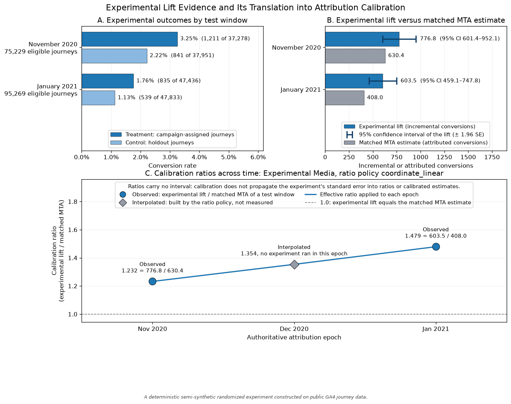
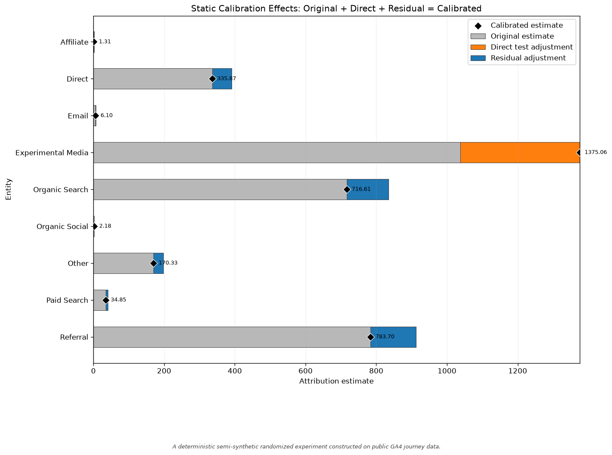
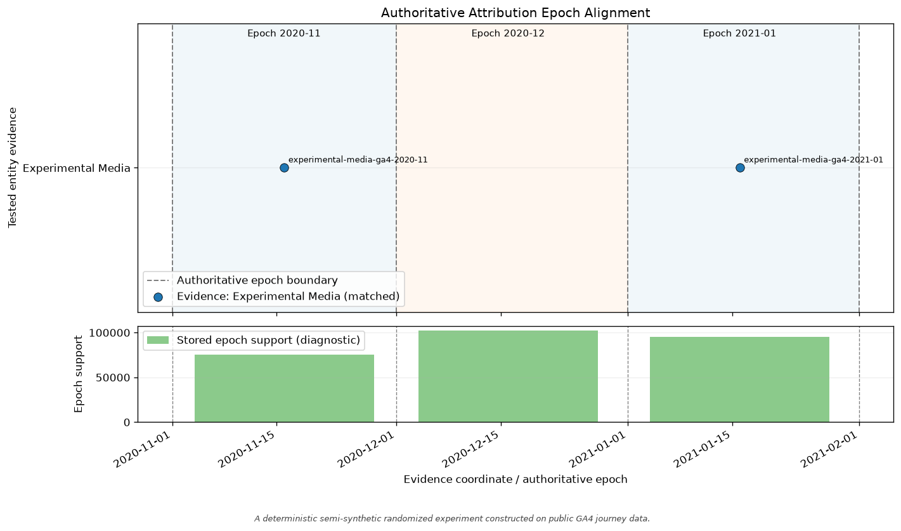
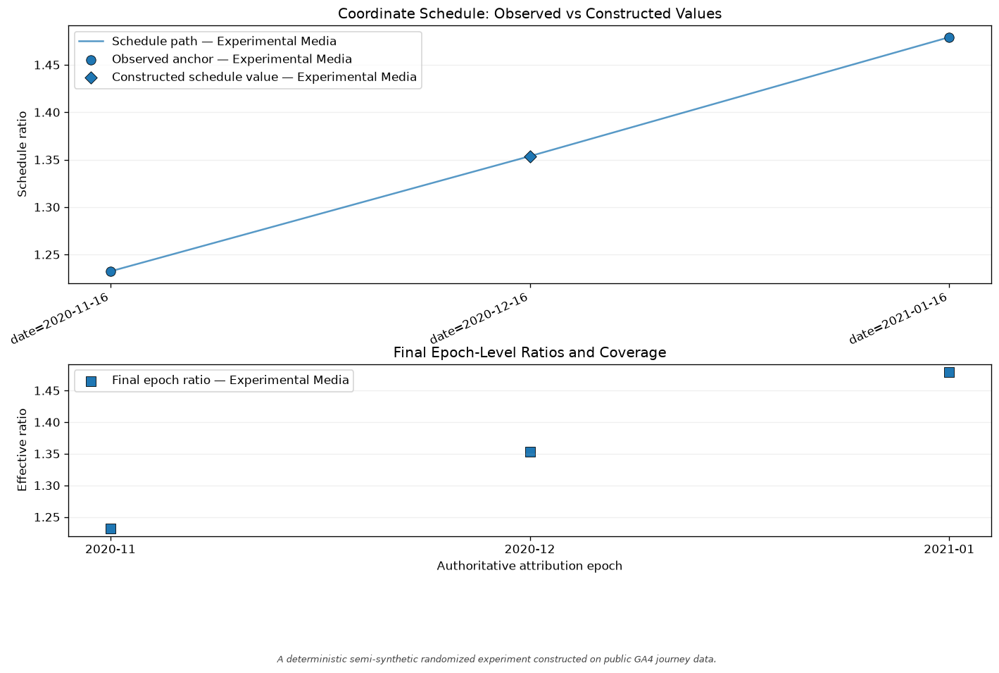
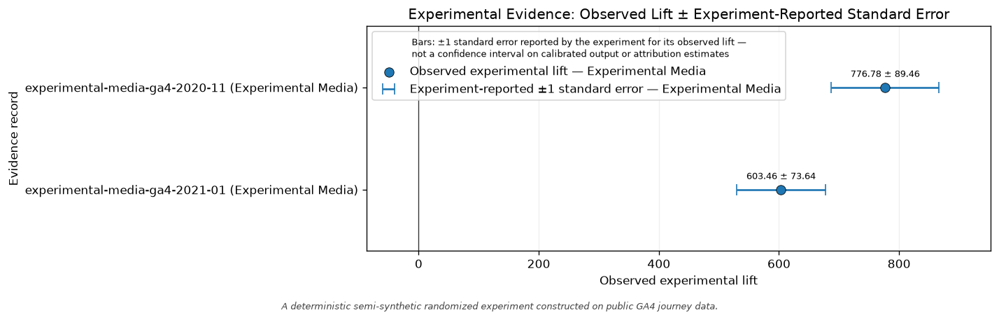
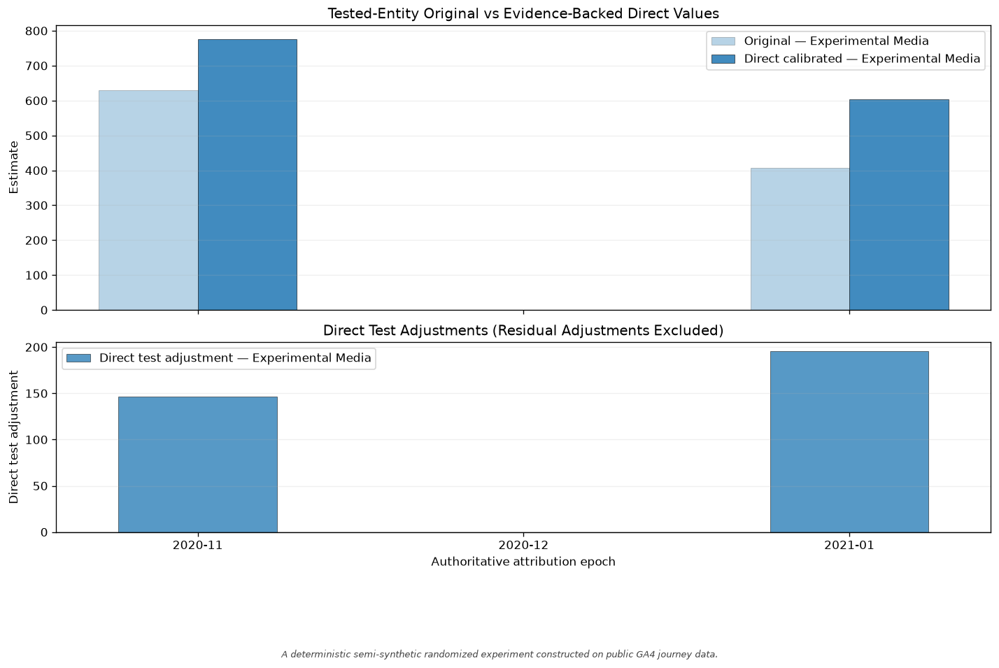
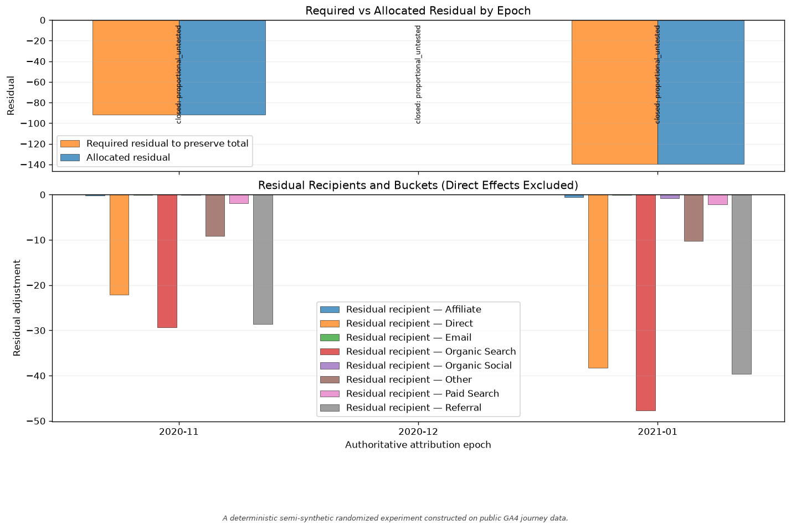
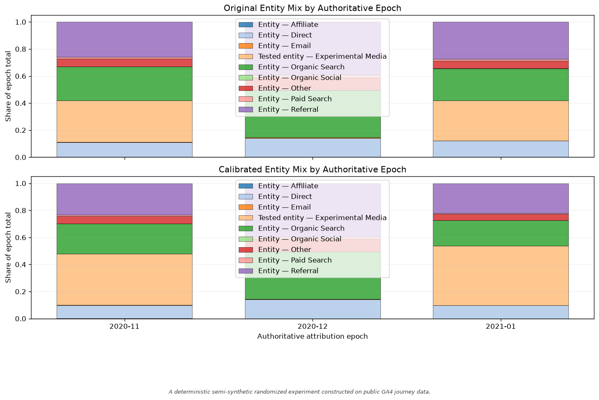

# Calibration diagnostics and plots

Calibration diagnostics explain stored deterministic results and compare only
the alternatives a caller explicitly requests. The result exposes exactly seven plotting methods:

- `plot_epoch_alignment()`
- `plot_ratio_schedule()`
- `plot_evidence_uncertainty()`
- `plot_calibration_effects()`
- `plot_residual_allocation()`
- `plot_entity_mix()`
- `plot_evidence_strength()`

The plots distinguish observed evidence, constructed schedule values, final
effective ratios, evidence-backed direct adjustments, and policy-allocated
residuals.

`plot_evidence_uncertainty()` draws one row per stored evidence record on an
axis in the experiment's own lift units: the observed lift as a point, with a
horizontal bar of ±1 `standard_error` where the experiment reported one. A
record without a standard error is a point with no bar, labelled
`no uncertainty supplied`. `plot_ratio_schedule()` carries the same reported
error on its observed anchors, divided by the matched attribution estimate so
it sits on the ratio axis. These bars are the experiment's reported
uncertainty about its own observed lift. They are never an interval on a
constructed schedule value, an effective ratio, or calibrated output, and no
calibrated number reads `standard_error`. `plot_epoch_alignment()` has no
lift axis and draws no uncertainty.

`plot_evidence_strength()` is a calibration-policy comparison. It is not a
measure of statistical evidence. Its figure is one panel holding the view that
applies to the result:

- For an `explicit_strength` result it draws the declared strength of each
  tested entity and epoch beside the source observed ratio and the applied
  ratio, `1 + strength × (observed ratio − 1)`. Strength is an attenuation the
  caller chose. A strength of 0.5 applies half of the observed ratio's
  distance from 1; it does not mean 50% confidence in the experiment, and it
  says nothing about the experiment's precision.
- For an `observed_only` or `coordinate_linear` result it draws each stored
  applied ratio beside the alternatives requested through the `diagnostic_*`
  arguments described in Part 2.
- For any other call it states that neither view applies.

What the experiment measured, and how precisely, is shown by
`plot_evidence_uncertainty()` and, for the GA4 example, by the first figure
below.

## Generated calibration visual artifact bank

The checked-in examples below are generated from a fixed scenario, the GA4
experiment in `examples/calibration_workflow.py`.

The first figure is that example's own `plot_experimental_evidence()`. It
follows the experiment into the calibration: the conversion rate, conversions,
and journeys of each randomized arm; the estimated lift with its 95%
confidence interval beside the matched attribution estimate; and the ratio of
each epoch, marked as observed in a test window or constructed by the ratio
policy. December is constructed: no experiment ran in that month. The interval
belongs to the experimental lift only. Calibration does not propagate the
standard error, so no ratio and no calibrated estimate carries an interval.



The other seven figures are drawn by the public plot methods.
`plot_evidence_strength()` has no checked-in image: the example applies
`coordinate_linear`, which has no strength schedule, and the one alternative
that policy allows for December differs from the applied ratio only in the
third decimal (1.3536 applied, 1.3557 as the window average).















## Part 1 — A shared temporal scenario

Epochs are outcome-driven or user-supplied, never channel-owned. A tested
entity does not own the epochs, and calibration does not move their boundaries.

Interpolation is a missing-evidence rule. Interpolation addresses missing evidence
between declared observed anchors; it is not entity-specific time and
does not create a new experimental observation.

```python
import matplotlib.pyplot as plt

from do_attribution.calibration import (
    LiftTestEvidence,
    TemporalAttributionCalibration,
)

print_start = LiftTestEvidence(
    tested_entity="Print",
    observed_lift=90.0,
    matched_mta_estimate=100.0,
    test_id="print-start",
    coordinate_name="week",
    coordinate_value=0.0,
)
print_end = LiftTestEvidence(
    tested_entity="Print",
    observed_lift=110.0,
    matched_mta_estimate=100.0,
    test_id="print-end",
    coordinate_name="week",
    coordinate_value=2.0,
)

calibration = TemporalAttributionCalibration(
    evidence=[print_start, print_end]
)
estimates = {
    "E1": {"Print": 100.0, "Search": 50.0},
    "E2": {"Print": 100.0, "Search": 50.0},
    "E3": {"Print": 100.0, "Search": 50.0},
}
epoch_windows = {
    "E1": (0.0, 0.5),
    "E2": (0.5, 1.5),
    "E3": (1.5, 2.0),
}
epoch_coordinates = {"E1": 0.0, "E2": 1.0, "E3": 2.0}

result = calibration.apply_estimates(
    estimates,
    ratio_policy="coordinate_linear",
    epoch_ratio_policy="representative_coordinate",
    residual_policy="proportional_untested",
    epoch_windows=epoch_windows,
    epoch_coordinates=epoch_coordinates,
    eligible_entities=["Search"],
)

assert [
    (row.epoch, row.effective_ratio, row.ratio_source)
    for row in result.epoch_ratio_schedule
] == [
    ("E1", 0.90, "observed"),
    ("E2", 1.00, "interpolated"),
    ("E3", 1.10, "observed"),
]
```

Residual effects are not experiment-identified. For example, the direct Print
adjustment and the compensating Search residual allocation are stored
separately. Neither of those numbers is an experimentally identified effect
for Search.

The following methods plot the stored state without refitting:

```python
figures = [
    result.plot_epoch_alignment(),
    result.plot_ratio_schedule(),
    result.plot_evidence_uncertainty(),
    result.plot_calibration_effects(),
    result.plot_residual_allocation(),
    result.plot_entity_mix(),
    result.plot_evidence_strength(),
]
assert all(figure.axes for figure in figures)
for figure in figures:
    plt.close(figure)
```

An explicitly attenuated evidence schedule exposes its declared strength
alongside its source and applied ratios.

```python
strength_result = calibration.apply_estimates(
    {"E1": {"Print": 100.0, "Search": 50.0}},
    ratio_policy="explicit_strength",
    epoch_ratio_policy="direct",
    residual_policy="allow_total_change",
    source_evidence={"Print": "print-start"},
    tested_entity_epochs={"Print": ["E1"]},
    evidence_strength={("Print", "E1"): 0.5},
)
assert strength_result.epoch_ratio_schedule[0].effective_ratio == 0.95
strength_figure = strength_result.plot_evidence_strength()
plt.close(strength_figure)
```

An epoch whose requested coordinate lies outside all observed anchors remains
uncalibrated. The package refuses extrapolation.

```python
outside_support = calibration.apply_estimates(
    {"E4": {"Print": 100.0, "Search": 50.0}},
    ratio_policy="coordinate_linear",
    epoch_ratio_policy="representative_coordinate",
    residual_policy="allow_total_change",
    epoch_windows={"E4": (2.0, 3.0)},
    epoch_coordinates={"E4": 3.0},
)
assert outside_support.epoch_ratio_schedule == ()
assert outside_support.calibrated_totals["E4"] == 150.0
```

## Part 2 — Diagnostics expose alternatives without applying them

A diagnostic request is evaluated beside a result's stored applied policy. A
diagnostic alternative never becomes an applied policy and never replaces a stored ratio.
The plot labels these layers as:

- `Stored applied effective ratio`
- `Diagnostic only — not applied: select_evidence`
- `Diagnostic only — not applied: weighted_ratio`
- `Diagnostic only — not applied: pooled_lift`
- `Diagnostic only — not applied: representative_coordinate`
- `Diagnostic only — not applied: coordinate_average`

Conflict diagnostics accept `diagnostic_conflict_policies`,
`diagnostic_selected_evidence`, and `diagnostic_evidence_weights`.

```python
print_geo_a = LiftTestEvidence(
    tested_entity="Print",
    observed_lift=80.0,
    matched_mta_estimate=100.0,
    test_id="print-geo-a",
    outcome_name="orders",
    population="all customers",
    unit="orders",
    coordinate_name="week",
    coordinate_value=3.0,
)
print_geo_b = LiftTestEvidence(
    tested_entity="Print",
    observed_lift=120.0,
    matched_mta_estimate=100.0,
    test_id="print-geo-b",
    outcome_name="orders",
    population="all customers",
    unit="orders",
    coordinate_name="week",
    coordinate_value=7.0,
)
conflict_calibration = TemporalAttributionCalibration(
    evidence=[print_geo_a, print_geo_b]
)
conflict_result = conflict_calibration.apply_estimates(
    {"E1": {"Print": 100.0, "Search": 50.0}},
    ratio_policy="observed_only",
    epoch_ratio_policy="direct",
    residual_policy="allow_total_change",
    epoch_windows={"E1": (0.0, 10.0)},
    evidence_conflict_policy="select_evidence",
    selected_evidence={("Print", "E1"): "print-geo-a"},
)
assert conflict_result.epoch_ratio_schedule[0].effective_ratio == 0.80
assert conflict_result.epoch_ratio_schedule[0].ratio_source == (
    "selected_from_multiple"
)

conflict_diagnostic_figure = conflict_result.plot_evidence_strength(
    diagnostic_conflict_policies={
        ("Print", "E1"): (
            "select_evidence",
            "weighted_ratio",
            "pooled_lift",
        )
    },
    diagnostic_selected_evidence={
        ("Print", "E1"): "print-geo-b"
    },
    diagnostic_evidence_weights={
        ("Print", "E1"): {
            "print-geo-a": 0.25,
            "print-geo-b": 0.75,
        }
    },
)
plt.close(conflict_diagnostic_figure)
```

Coordinate-reduction diagnostics accept
`diagnostic_epoch_ratio_policies` and `diagnostic_epoch_coordinates`.

```python
reduction_result = calibration.apply_estimates(
    {"E2": {"Print": 100.0, "Search": 50.0}},
    ratio_policy="coordinate_linear",
    epoch_ratio_policy="representative_coordinate",
    residual_policy="allow_total_change",
    epoch_windows={"E2": (0.5, 1.5)},
    epoch_coordinates={"E2": 1.0},
)
reduction_diagnostic_figure = reduction_result.plot_evidence_strength(
    diagnostic_epoch_ratio_policies={
        ("Print", "E2"): (
            "representative_coordinate",
            "coordinate_average",
        )
    },
    diagnostic_epoch_coordinates={"E2": 1.0},
)
plt.close(reduction_diagnostic_figure)
```

Plotting the alternatives leaves `rows`, `epoch_ratio_schedule`,
`evidence_points`, ratio and reduction provenance, residual provenance, and
calibrated totals unchanged.

## Part 3 — Validation without selection

In every entry point, the package validates the choices you
declare and applies exactly those choices. It does not select a ratio policy,
an epoch-ratio policy, a conflict policy, or a residual policy. There is no default calibration strategy.

## Part 4 — Excluded scope

- **default calibration strategy** — There is no default; policies are required.
- **automatic pooling** — Evidence is never pooled without an explicit conflict policy.
- **automatic interpolation** — Interpolation is never selected implicitly.
- **bayesian updating** — Bayesian updating is excluded from deterministic point calibration.
- **mmm** — MMM fitting is excluded from this post-attribution layer.
- **epoch boundary movement** — Calibration never moves, splits, or merges epochs.
- **extrapolation** — The coordinate schedule refuses extrapolation outside observed support.
- **hidden normalization** — Tested values are never silently renormalized after direct adjustment.
